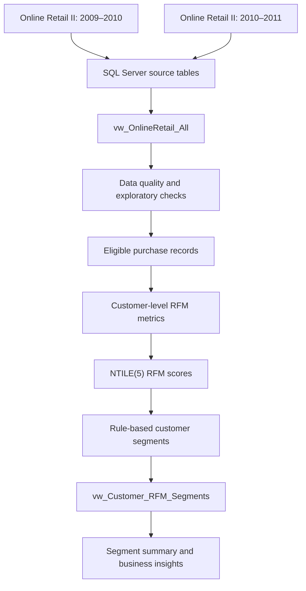
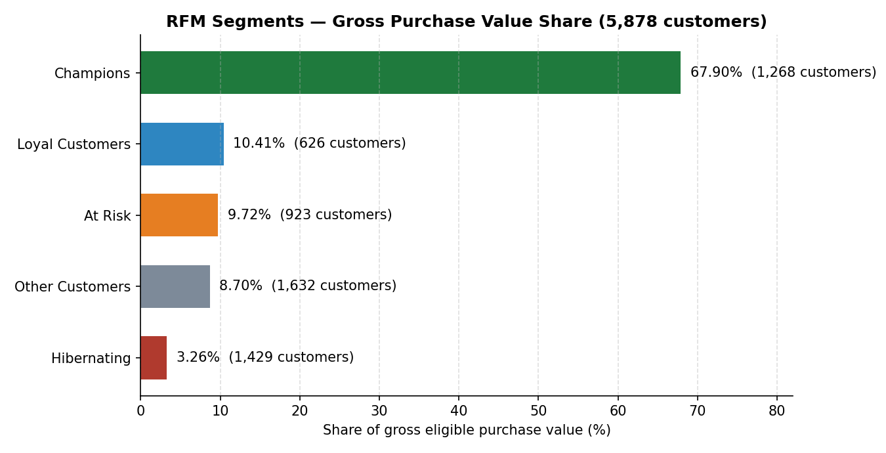

# RFM Customer Segmentation in Pure SQL

> Customer segmentation using Recency, Frequency, and Monetary (RFM) analysis in Microsoft SQL Server.

[](https://www.microsoft.com/en-us/sql-server)
[](https://learn.microsoft.com/en-us/sql/t-sql/language-reference)

**Repository:** [rfm-customer-segmentation](https://github.com/satyam-katara/rfm-customer-segmentation)
**Author:** Satyam Katara — [GitHub profile](https://github.com/satyam-katara)

## Table of Contents

- [Project Overview](#project-overview)
- [Problem Statement](#problem-statement)
- [Objectives](#objectives)
- [Key Features](#key-features)
- [Tech Stack](#tech-stack)
- [Workflow and Architecture](#workflow-and-architecture)
- [Dataset](#dataset)
- [Repository Structure](#repository-structure)
- [Setup and Usage](#setup-and-usage)
- [Methodology](#methodology)
- [Results](#results)
- [Business Insights](#business-insights)
- [Limitations and Future Improvements](#limitations-and-future-improvements)
- [Skills Demonstrated](#skills-demonstrated)
- [Contributing](#contributing)
- [License](#license)
- [Acknowledgements and References](#acknowledgements-and-references)

## Project Overview

This project uses SQL Server to analyse the UCI Online Retail II transaction dataset and group identified customers into five behavioural segments. It combines two retail periods, checks data quality, calculates customer-level RFM metrics, assigns quintile-based scores, and summarizes each segment's contribution to gross eligible purchase value.

The analysis is implemented in T-SQL. The final customer-level view is `dbo.vw_Customer_RFM_Segments`, built on top of `dbo.vw_OnlineRetail_All`.

## Problem Statement

A retailer's transaction history contains useful information about customer engagement and purchasing behaviour, but raw invoice lines do not directly show which customers are most valuable or which customers may need re-engagement.

This project turns transaction-level records into customer-level metrics and interpretable segments that can support retention, loyalty, and win-back decisions.

## Objectives

- Combine the two Online Retail II periods into one queryable view.
- Profile missing values, quantities, prices, cancellations, customers, invoices, and transaction dates.
- Calculate Recency, Frequency, and Monetary metrics for eligible customers.
- Score customers on a 1–5 scale using SQL Server's `NTILE(5)` window function.
- Assign each eligible customer to one of five rule-based segments.
- Compare segment size, gross eligible purchase value, average customer value, and monetary contribution.
- Keep the workflow reproducible in SQL Server.

## Key Features

- **Data quality checks:** missing customer IDs and descriptions, non-positive quantities, negative prices, and cancellation records.
- **Combined transaction view:** `dbo.vw_OnlineRetail_All`.
- **Customer-level RFM calculations:** latest eligible purchase date, distinct eligible invoice count, and sum of line values.
- **Quintile scoring:** R, F, and M scores from 1 to 5.
- **Rule-based segmentation:** Champions, Loyal Customers, At Risk, Hibernating, and Other Customers.
- **Reusable final view:** `dbo.vw_Customer_RFM_Segments`.
- **Business summaries:** customer count, total monetary value, average monetary value per customer, and percentage contribution.

## Tech Stack

| Technology | Use |
|---|---|
| Microsoft SQL Server | Database and query execution |
| T-SQL | Data profiling, aggregation, window functions, scoring, segmentation, and views |
| SQL Server Management Studio (SSMS) | SQL development and execution |
| UCI Online Retail II | Transaction dataset |

No Python or visualization framework is required to run the SQL analysis described here. Add any additional tools only if they are actually used in the repository.

## Workflow and Architecture



## Dataset

**Source:** [UCI Machine Learning Repository — Online Retail II](https://archive.ics.uci.edu/dataset/502/online+retail+ii)

The dataset contains online retail transactions from a UK-based, non-store retailer. The SQL workflow combines the two periods in the source workbook.

### Dataset scale observed in this analysis

| Measure | Result |
|---|---:|
| Total transaction rows | 1,067,371 |
| Missing `Customer_ID` values | 243,007 |
| Missing `Description` values | 4,382 |
| Rows with `Quantity <= 0` | 22,950 |
| Rows with negative `Price` | 0 |
| Rows with cancellation invoice prefix (`C%`) | 19,494 |
| Distinct cancellation invoices | 8,292 |
| Distinct identified customers in raw data | 5,942 |
| Distinct invoices in raw data | 53,628 |
| Eligible customers included in RFM | 5,878 |

### Fields used

The imported SQL tables use these column names:

- `Invoice`
- `StockCode`
- `Description`
- `Quantity`
- `InvoiceDate`
- `Price`
- `Customer_ID`
- `Country`

### Eligibility rules

For RFM calculations, a transaction line is included only when all of the following are true:

```sql
Invoice NOT LIKE 'C%'
AND Quantity > 0
AND Price > 0
AND Customer_ID IS NOT NULL
```

These filters exclude cancellation-prefixed invoices, non-positive quantities, non-positive prices, and records without an identified customer. Raw data is retained; the analysis applies filters in queries rather than deleting source records.

**Important:** The reported Monetary measure is `SUM(Quantity * Price)` over eligible positive-quantity lines. Since returns/negative-quantity rows are excluded rather than subtracted, this measure is **gross eligible purchase value**, not net revenue. The currency symbol should be added only after confirming the source's currency metadata.

## Repository Structure

```text
rfm-customer-segmentation/
├── README.md
├── LICENSE
├── sql/
│   ├── 01_database_setup.sql
│   ├── 02_data_quality_checks.sql
│   ├── 03_rfm_analysis.sql
│   ├── 04_customer_segmentation.sql
│   └── 05_business_insights.sql
├── screenshots/
│   └── segment-summary.png
└── .gitignore
```

Run the SQL files in `sql/` in numeric order (01 → 05).

## Setup and Usage

### Prerequisites

- Microsoft SQL Server instance.
- SQL Server Management Studio (SSMS), or another SQL client that can execute T-SQL.
- The UCI Online Retail II workbook: [download from UCI](https://archive.ics.uci.edu/dataset/502/online+retail+ii).
- Permission to create a database and import tables.

### 1. Download the dataset

Download the official Online Retail II workbook from the UCI link above. Follow the dataset's terms and attribution requirements.

### 2. Create the database

Run the following in SSMS:

```sql
CREATE DATABASE RFM_Customer_Analytics;
GO

USE RFM_Customer_Analytics;
GO
```

If the database already exists, do not run `CREATE DATABASE` again. Select the existing database instead.

### 3. Import the two source periods

Import the two periods into SQL Server with these table names, matching the queries in this project:

- `dbo.[online_retail_II(2009-2010)]`
- `dbo.[online_retail_II(2010-2011)]`

Expected columns are `Invoice`, `StockCode`, `Description`, `Quantity`, `InvoiceDate`, `Price`, `Customer_ID`, and `Country`.

**Import note:** SQL Server's import wizard may infer data types. Review the inferred types and verify that `InvoiceDate` is a date/time type, `Quantity` is numeric, and `Price` supports the required calculations. The exact import-wizard choices depend on your SQL Server version and file format.

### 4. Create the combined view

```sql
CREATE VIEW dbo.vw_OnlineRetail_All AS
SELECT *
FROM dbo.[online_retail_II(2009-2010)]
UNION ALL
SELECT *
FROM dbo.[online_retail_II(2010-2011)];
GO
```

This assumes both tables have the same columns in the same order and compatible data types. For a more robust production script, explicitly list columns instead of using `SELECT *`.

### 5. Run the SQL analysis

Run the SQL scripts in `sql/` in numeric order: `01_database_setup.sql` → `02_data_quality_checks.sql` → `03_rfm_analysis.sql` → `04_customer_segmentation.sql` → `05_business_insights.sql`.

The workflow should cover:
1. Data quality and exploratory checks.
2. Eligible purchase filtering.
3. Customer-level RFM metrics.
4. RFM scoring and segmentation.
5. Creation of `dbo.vw_Customer_RFM_Segments`.
6. Segment summaries and validation queries.

### 6. Query the final view

After creating the final view, inspect customer-level results:

```sql
SELECT TOP 20 *
FROM dbo.vw_Customer_RFM_Segments
ORDER BY Monetary DESC;
```

Summarize the segments:

```sql
SELECT
    CustomerSegment,
    COUNT(*) AS TotalCustomers,
    CAST(SUM(Monetary) AS DECIMAL(18,2)) AS TotalMonetary,
    CAST(AVG(Monetary) AS DECIMAL(18,2)) AS AvgMonetaryPerCustomer,
    CAST(
        100.0 * SUM(Monetary)
        / SUM(SUM(Monetary)) OVER ()
        AS DECIMAL(6,2)
    ) AS MonetaryContributionPercent
FROM dbo.vw_Customer_RFM_Segments
GROUP BY CustomerSegment
ORDER BY TotalMonetary DESC;
```

## Methodology

### 1. Data profiling

The analysis checks row counts, missing customer IDs and descriptions, quantity distributions, negative prices, cancellation rows, distinct customers, invoice counts, country-level customer counts, and transaction date range.

### 2. Filter eligible purchases

The RFM analysis excludes cancellation-prefixed invoices, rows with non-positive quantities or prices, and rows with missing customer IDs. These rules are applied in the SQL queries; the raw source tables are not deleted or overwritten by the analysis.

### 3. Calculate RFM metrics

For each eligible customer:

- **Recency:** days between the customer's last eligible purchase date and one day after the maximum invoice date in the combined dataset.
- **Frequency:** count of distinct eligible invoices.
- **Monetary:** sum of `Quantity * Price` across eligible lines.

The dataset maximum invoice date observed was `2011-12-09 12:50:00`; the recency reference date used by the query is the maximum date plus one day (`2011-12-10`). `DATEDIFF(DAY, ...)` counts calendar-day boundaries.

### 4. Score customers

SQL Server's `NTILE(5)` divides the ordered customer rows into five approximately equal-sized groups:

- `R_Score`: ordered by `RecencyDays DESC`, so customers with longer inactivity receive lower scores and more recent customers receive higher scores.
- `F_Score`: ordered by `Frequency ASC`, so lower-frequency customers receive lower scores.
- `M_Score`: ordered by `Monetary ASC`, so lower-monetary customers receive lower scores.

The scores are combined into a three-digit `RFM_Score`, such as `555`.

### 5. Assign segments

The implemented rules are:

| Rule | Segment |
|---|---|
| `R_Score >= 4 AND F_Score >= 4 AND M_Score >= 4` | Champions |
| `R_Score >= 3 AND F_Score >= 4` | Loyal Customers |
| `R_Score <= 2 AND F_Score >= 3` | At Risk |
| `R_Score <= 2 AND F_Score <= 2` | Hibernating |
| All other score combinations | Other Customers |

These are project-specific segmentation rules, not universal RFM definitions. The order of the `CASE` conditions matters because a customer may satisfy more than one broad condition.

## Results

The following are the outputs reported from the project's SQL Server runs.

### Overall metrics

| Metric | Result |
|---|---:|
| Eligible customers | 5,878 |
| Total gross eligible purchase value | 17,743,429.08 |
| Average recency | 201.00 days |
| Average purchase frequency | 6.29 invoices per customer |

### Segment summary

| Segment | Customers | Gross eligible purchase value | Average per customer | Contribution |
|---|---:|---:|---:|---:|
| Champions | 1,268 | 12,048,284.82 | 9,501.80 | 67.90% |
| Loyal Customers | 626 | 1,847,250.20 | 2,950.88 | 10.41% |
| At Risk | 923 | 1,725,115.00 | 1,869.03 | 9.72% |
| Other Customers | 1,632 | 1,544,271.61 | 946.24 | 8.70% |
| Hibernating | 1,429 | 578,507.45 | 404.83 | 3.26% |
| **Total** | **5,878** | **17,743,429.08** | — | **99.99%** |

The contribution percentages sum to 99.99% because each segment's percentage is rounded to two decimal places.

### Validation results

| Check | Reported result |
|---|---:|
| Eligible customers from the source view | 5,878 |
| Segment records | 5,878 |
| Unique segmented customers | 5,878 |
| Duplicate segment records | 0 |

## Business Insights

1. **Champions account for most of the purchase value.** The 1,268 customers in this segment contribute 67.90% of gross eligible purchase value. Retention and loyalty experiments could be prioritized for this group.
2. **Other Customers is the largest segment by customer count.** It contains 1,632 customers and contributes 8.70% of the purchase value. Further analysis could identify opportunities to increase repeat purchasing.
3. **At Risk customers may warrant re-engagement.** The segment contains 923 customers. A targeted win-back campaign could be tested and evaluated against campaign cost and incremental purchases.
4. **Hibernating customers have the lowest average monetary value.** Their average value is 404.83 in the dataset's price units. Lower-cost reactivation tests may be more appropriate than expensive incentives.
5. **The observed customer base is concentrated in the UK.** The raw data contains 5,410 identified UK customers out of 5,942 identified customers overall, approximately 91%.

These are interpretations and potential actions based on the observed data, not measured campaign outcomes. Monetary figures should not be described as net revenue because return rows were excluded rather than deducted.

## Screenshots and Visualizations

Segment value chart generated from the segment summary results (see [Results](#results)):



## Limitations and Future Improvements

- **Returns are not netted against purchases.** Negative-quantity rows are excluded, so Monetary represents gross eligible purchase value.
- **Zero-price exclusions need separate measurement.** The eligibility filter requires `Price > 0`, but the reported data-quality checks only established that negative prices were absent.
- **`NTILE(5)` can split tied values across score buckets.** Add a deterministic secondary sort key such as `Customer_ID` if repeatable ordering is required; this stabilizes ordering but does not keep tied values in the same bucket.
- **Segmentation rules are heuristic.** Review the rules with business stakeholders and test their usefulness against future customer behaviour.
- **Analysis date is tied to the dataset.** The current reference date is based on the maximum transaction date plus one day. For ongoing reporting, make the analysis date an explicit parameter or use a documented reporting date.
- **Currency metadata should be verified** before adding a currency symbol to results.
- **SQL import types should be validated.** For production use, explicitly specify column lists in the combined view and validate numeric precision.
- **Reproducibility.** The SQL files are ordered (01–05) with a run guide above; SSMS screenshots can be added to `screenshots/` alongside the summary chart.
- **Additional validation:** measure zero-price rows, compare row counts before and after each filter, and check how many customers have only excluded transactions.

## Challenges and Solutions

The SQL workflow addresses several practical analytics challenges:

- **Combining two source periods:** a `UNION ALL` view provides one source for analysis.
- **Handling cancellations and invalid purchase lines:** explicit eligibility conditions keep excluded rows out of the RFM metrics without deleting raw records.
- **Moving from invoice lines to customer metrics:** `GROUP BY Customer_ID`, `COUNT(DISTINCT Invoice)`, and aggregate monetary calculations create one row per eligible customer.
- **Scoring customers with SQL:** window functions and `NTILE(5)` provide quintile-based scores without requiring a separate Python analysis.
- **Making results reusable:** a final SQL view exposes the customer metrics, scores, and segment labels for downstream queries.

## Skills Demonstrated

- Microsoft SQL Server and T-SQL
- Data quality assessment and exploratory analysis
- Filtering and aggregation
- CTEs and window functions
- Customer-level metric design
- RFM scoring and rule-based segmentation
- Validation of counts and aggregate contributions
- Translating SQL results into business recommendations

## Contributing

Contributions and suggestions are welcome.

1. Fork the repository.
2. Create a feature branch.
3. Keep SQL scripts organized and explain non-obvious business rules.
4. Test changes against the dataset and record the validation output.
5. Submit a pull request describing the change and its impact.

## License

This project is distributed under the MIT License — see the [LICENSE](LICENSE) file. Dataset usage is subject to the source's terms.

## Author

**Satyam Katara**

- GitHub: [@satyam-katara](https://github.com/satyam-katara)
- Repository: [rfm-customer-segmentation](https://github.com/satyam-katara/rfm-customer-segmentation)

## Acknowledgements and References

- Dataset: [UCI Machine Learning Repository — Online Retail II](https://archive.ics.uci.edu/dataset/502/online+retail+ii)
- SQL Server documentation: [Transact-SQL reference](https://learn.microsoft.com/en-us/sql/t-sql/language-reference)
- SQL Server window functions: [OVER clause documentation](https://learn.microsoft.com/en-us/sql/t-sql/queries/select-over-clause-transact-sql)
- Quintile scoring in this project uses SQL Server's `NTILE` function; segmentation thresholds are project-defined.
